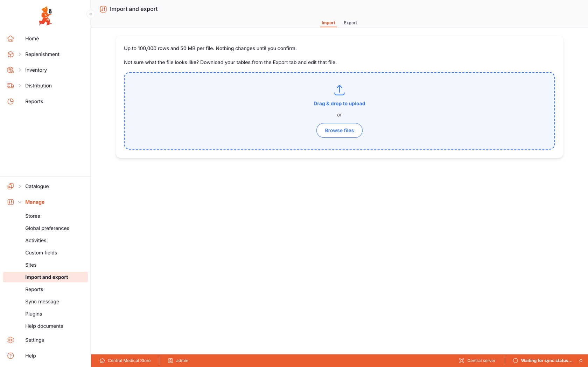
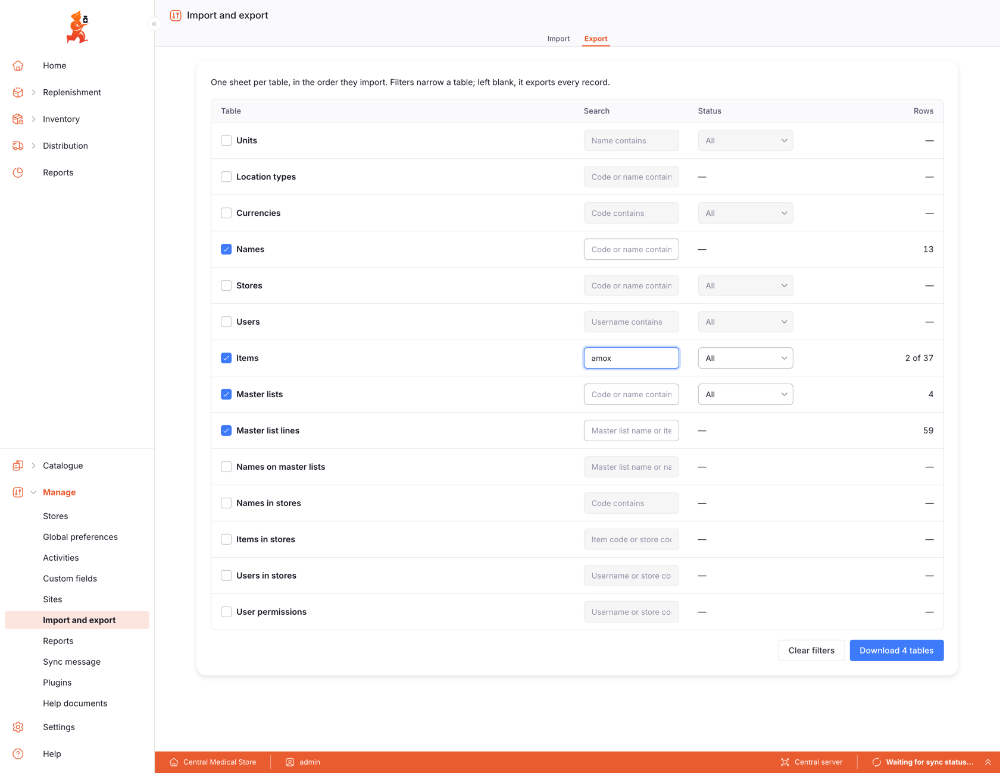
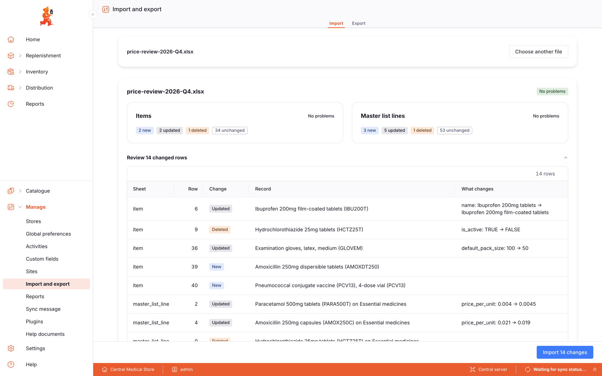
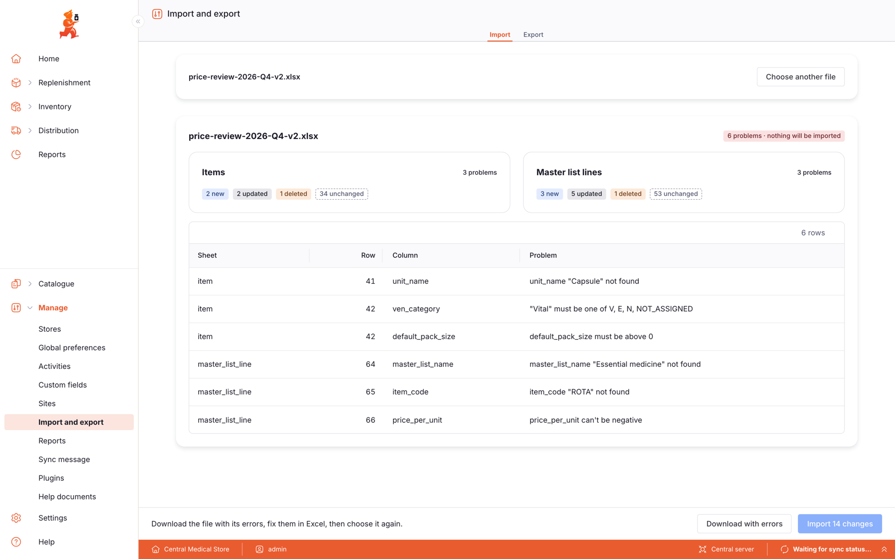

+++
title = "Import and Export"
description = "Move central data in and out of the central server as Excel workbooks"
date = 2026-11-25
updated = 2026-11-25
draft = false
weight = 7
sort_by = "weight"
template = "docs/page.html"

[extra]
toc = true
top = false
+++

Import and export lets you move central data, such as items, stores, names, users and master lists, in and out of the central server as Excel workbooks. You can set up a new system, or bring data in from somewhere else, without typing every record by hand.

The usual way to use it is:

1. **Export** the tables you want to change.
2. **Edit** the workbook in Excel: change rows, add new ones or mark rows for deletion.
3. **Import** the workbook. Open mSupply shows you what it would change, and changes nothing until you confirm.

Changes you import sync to remote sites the same way as changes made in the app.

Import and export is available only on a <a href="/docs/getting-started/central-server/">standalone Open mSupply Central Server</a>, one with no legacy mSupply central server behind it. On a central server that shares its data with legacy mSupply, the page isn't shown, because legacy mSupply would overwrite the changes.

## Who can use it

To open `Manage` > `Import and export`, you need:

- `Permissions` > `Admin` > **Access server administration**, and
- `Open mSupply Central Server` > **Can modify central data**.

Both are given on the central server.

The <code>user</code>, <code>user_store_join</code> and <code>user_permission</code> sheets can give someone a password, a store to log in to, or server admin rights. Give these permissions only to people you trust with every user account on the system.

See [Permissions](/docs/settings/permissions/) for how to give a user a permission.

## Opening the page

Choose `Manage` > `Import and export` in the navigation panel.

The page has two tabs:

- **Import**, which opens first, for checking and importing a workbook.
- **Export**, for downloading tables as a workbook.

What you've done on one tab is kept while you look at the other, so you can switch between them without losing your file or your filters.

## Exporting data

Open the **Export** tab.

The tab lists every table you can export, in the order they import.

1. Tick each table you want in the workbook.
2. If you only want some of a table's records, narrow it:
   - **Search** keeps the records that contain the text you type. The placeholder in the box says what it searches, such as the code or name.
   - **Status** keeps all records, only active ones, or only inactive ones. Tables with no active or inactive state show a dash.
3. The **Rows** column shows how many records each table will export, such as `120 of 4,300`.
4. Click **Download _n_ tables**.

You get one Excel file with one sheet per table.

**Clear filters** empties every search box and sets every status back to **All**, but keeps the tables you've ticked.

An export with no filters includes inactive records too, so importing it again leaves them as they are. Deleted users and the system's own built-in records are left out.

An export can have up to 100,000 rows in total, the same as an import, so every file you export can be imported again. If the tables you've ticked come to more than that, the page tells you and the download button is disabled. Narrow the filters, or export the tables in more than one file.

## Editing the workbook

Each sheet is named after its table, such as `item` or `master_list`, and its first row holds the column headings.

When you edit the workbook:

- **Keep the headings as they are.** A heading that isn't one of the table's columns stops the import, so a misspelt heading can't quietly drop a column. You can leave out a column you don't want to change: every record keeps its current value for it.
- **Add a new record** by adding a row. Leave the `id` cell blank and Open mSupply gives the record one. Fill in every required column (see [Tables and columns](#tables-and-columns)).
- **Change a record** by editing its row. Leave the `id` and code as they were exported, so Open mSupply finds the right record.
- **Remove a record** in the way its table allows: by marking it inactive, or by typing `DELETE` in its `delete` column (see [Removing records](#removing-records)).
- **Leave out the rows you don't want to change.** A record that isn't in the file is never removed or changed.

Some columns are only there to help you read the sheet, such as `item_name` beside `item_code`, or the date a record was created. These are **export-only columns**: you can edit or delete them, and the import ignores them.

Text columns are formatted as Text in Excel, so a code such as <code>007</code> keeps its leading zeros. If you paste in data from elsewhere, check codes haven't lost their leading zeros or been turned into dates.

### Cell values

| Column type            | What to enter                                                                                                                             |
| :--------------------- | :---------------------------------------------------------------------------------------------------------------------------------------- |
| **True or false**      | `TRUE` or `FALSE` (any letter case), or `1` or `0`                                                                                         |
| **Whole number**       | A whole number. `3.0` is read as 3; `3.5` is an error                                                                                      |
| **Number**             | Any number, such as `-18.5`                                                                                                                |
| **Choice**             | One of the values listed for that column, in any letter case. If a new record leaves a required choice blank, or a choice is mistyped, the problem lists the values it takes |
| **Blank cell**         | When changing a record: keeps the current value of a required column, and clears an optional one. When adding a record: required columns can't be blank |

### How a row finds its record

A row finds the record it changes in one of two ways:

- **By `id`.** A row with an id changes the record with that id. If no record has it, the row adds one with that id.
- **By its lookup key**, such as an item's `code` or a user's `username`, when `id` is blank. If no record matches, the row adds a new one.

If a row has both an id and a lookup key, they must belong to the same record. If you copy a row and change only its code, the import stops with an error rather than changing the wrong record's code. The exceptions are **units** and **master lists**: change the name on a row that keeps its id, and the import renames the record.

Codes and ids match exactly, letter case included: `cold` doesn't find a location type coded `COLD`. Unit names and usernames match in any letter case.

### Referring to other records

Some columns refer to another record, such as an item's unit or a master list line's item. Most references come as a pair of columns: a code (or name) and an id, such as `item_code` and `item_id`. You can fill in either one, or both.

- Fill in the **code** when you're adding rows by hand. It's easier to read.
- If a code matches more than one record, the import asks you to give the id instead.
- If you give both, they must point at the same record.

An export fills in both, so an exported row imports again with no edits.

A sheet can refer to a record that an earlier sheet in the same file adds. For example, a `master_list_line` row can use an item the `item` sheet adds. Sheets are always processed in the order in [Tables and columns](#tables-and-columns), whatever order they're in in the workbook.

### Removing records

Each table removes a record in one of two ways:

- **By its active or disabled column.** Units, currencies, items and master lists are removed by setting `is_active` to `FALSE`. Stores are removed by setting `is_disabled` to `TRUE`. Nothing deletes them.
- **By a `delete` column.** Type `DELETE`, in capitals, in a row's `delete` cell to delete that record. Leave it blank to keep the record. Any other value stops the import, so a typo can't look like a delete that didn't happen.

A `DELETE` row can keep the rest of the row as it was exported, but it can't change anything else at the same time. A `DELETE` row that finds no record is ignored.

Some records can't be deleted while something else uses them. For example, you can't delete a location type that a location uses, or a name that appears on a shipment. The import tells you what's using it.

## Importing data

Open the **Import** tab.

1. Drag your `.xlsx` file onto the upload area, or click **Browse files** and choose it.
2. Open mSupply checks every row and shows a preview. **Nothing is changed yet.**
3. Read the preview (see below).
4. If there are no problems, click **Import _n_ changes** at the bottom of the page.

A file can be up to **50 MB** and have up to **100,000 rows** across all its sheets.

Not sure what the file should look like? Export the tables you want from the Export tab and edit that file. It has the right sheets, headings and formatting already.

### Reading the preview

The preview shows one card for each sheet in the file, with how many of its rows would be:

- **new**: add a record
- **updated**: change a record
- **deleted**: remove a record
- **unchanged**: leave a record as it is

If there are no problems, open **Review _n_ changed rows** to see each row the import would write. For each updated row, **What changes** lists each changed column as `current → new`.

If there are no problems and something to change, the preview says **Upload successful! Click "Import" below to continue.** Under it, a note says that if there is a problem with any row, no data is imported: every change is applied together, or none are. The import checks the file again, so a row that has become a problem since the preview (because someone changed the same data, say) stops the whole import.

If the file matches what's already saved, the preview says there's nothing to import, and the **Import** button stays disabled.

Rows that wouldn't change anything aren't written, so they don't sync to remote sites. Importing a whole export again only touches the rows you edited.

After the import, a message confirms how many records were added, updated and deleted. To import another file, click **Choose another file**.

### Fixing problems

If any row has a problem, **nothing in the file is imported**, and the **Import** button is disabled. The preview lists the problems with the sheet, row number and column of each. The row number is the one Excel shows. Each row lists all its problems together, so you can fix them in one go.

The easiest way to fix them:

1. Click **Download with errors**. You get a copy of your file with an `error` column added to each sheet. Each row with a problem has its problems written in that column.
2. Open the file in Excel and fix each row.
3. Back on the Import tab, click **Choose another file** and choose the fixed file.

You don't need to delete the `error` column: the import ignores it.

Open mSupply keeps your uploaded file for an hour. After that, choose the file again before you import it or download its errors.

### When the file is refused

Some problems stop the whole file before any row is checked:

| Message                                                    | What to do                                                                                                                                                  |
| :--------------------------------------------------------- | :---------------------------------------------------------------------------------------------------------------------------------------------------------- |
| **Choose an Excel (.xlsx) file**                           | Save the file as an Excel workbook (`.xlsx`). Older `.xls` files and `.csv` files can't be imported                                                         |
| **The file has _n_ rows. An import can have up to 100,000.** | Split the file into smaller files and import them one at a time, in table order                                                                            |
| **The sheets cover _n_ cells…**                            | Something is typed far below or to the right of your data, such as a stray space. Delete the empty rows and columns after your data, then choose the file again |
| **The file couldn't be read as an Excel workbook**         | The file is damaged or isn't really an Excel file. Open it in Excel and save it again                                                                      |

## Tables and columns

This section lists each table's columns. Tables import in this order:

| Order | Sheet                   | What it holds                                           | Removed by        |
| :---- | :---------------------- | :------------------------------------------------------ | :---------------- |
| 1     | `unit`                  | Units, such as tablet or bottle                         | `is_active`       |
| 2     | `location_type`         | Location types, with their temperature range            | `delete` column   |
| 3     | `currency`              | Currencies and their exchange rates                     | `is_active`       |
| 4     | `name`                  | Facilities, suppliers, donors and other names (not patients) | `delete` column |
| 5     | `store`                 | Stores                                                  | `is_disabled`     |
| 6     | `user`                  | Users                                                   | `delete` column   |
| 7     | `item`                  | Items                                                   | `is_active`       |
| 8     | `master_list`           | Master lists                                            | `is_active`       |
| 9     | `master_list_line`      | Items on master lists, with their prices                | `delete` column   |
| 10    | `master_list_name_join` | Which names have which master lists                     | `delete` column   |
| 11    | `name_store_join`       | Which names each store can see                          | `delete` column   |
| 12    | `item_store_join`       | An item's price, margin and default location in a store | `delete` column   |
| 13    | `user_store_join`       | Which stores each user can log in to                    | `delete` column   |
| 14    | `user_permission`       | Users' permissions in each store                        | `delete` column   |

In the tables below, **Required** means the column must have a value when a row adds a new record. "Or" means either column of a pair will do. Every table also has an `id` column, which is never required.

### Units

Found by `name`, in any letter case.

| Column        | Required | Notes                                     |
| :------------ | :------- | :---------------------------------------- |
| `name`        | Yes      | Two active units can't share a name       |
| `description` |          |                                           |
| `index`       | Yes      | The sort order, a whole number            |
| `is_active`   | Yes      | `FALSE` removes the unit from use         |

### Location types

Found by `code`.

| Column            | Required | Notes                                                        |
| :---------------- | :------- | :----------------------------------------------------------- |
| `code`            | Yes      | Must be unique                                               |
| `name`            | Yes      | Two location types can share a name                          |
| `min_temperature` | Yes      | The lowest storage temperature, in °C                        |
| `max_temperature` | Yes      | The highest storage temperature, in °C. Can't be below the minimum |
| `delete`          |          | `DELETE` deletes the location type, if nothing uses it       |

Location types now have a code. Each existing location type has been given its name as its code. Where two had the same name, the second gets <code>_2</code>, the third <code>_3</code>, and so on.

### Currencies

Found by `code`.

| Column             | Required | Notes                                                                                |
| :----------------- | :------- | :----------------------------------------------------------------------------------- |
| `code`             | Yes      | The ISO currency code, such as `USD`                                                 |
| `rate`             | Yes      | The exchange rate against the home currency, above 0. The home currency's rate is 1  |
| `is_home_currency` | Yes      | `TRUE` for the home currency                                                         |
| `is_active`        | Yes      | `FALSE` removes the currency from use                                                |
| `date_updated`     |          | Export only. The day the currency last changed                                       |

There must be exactly one home currency. You can move the home currency from one currency to another in the same file, in any row order. You can't change the home currency once any shipment or purchase order has been valued in it.

### Names

Facilities, suppliers, donors, manufacturers and every other kind of name except patients. Found by `code` and `type` together, as different types of name can share a code.

| Column                                          | Required | Notes                                                                       |
| :---------------------------------------------- | :------- | :-------------------------------------------------------------------------- |
| `code`                                          | Yes      | Two names of the same type can't share a code                               |
| `type`                                          | Yes      | `FACILITY`, `STORE`, `OTHERS`, `BUILD`, `INVAD` or `REPACK`. Can't be changed |
| `name`                                          | Yes      |                                                                             |
| `is_customer`, `is_supplier`                    | Yes      | True or false                                                               |
| `is_manufacturer`, `is_donor`, `on_hold`        | Yes      | True or false                                                               |
| `supplying_store_code` or `supplying_store_id`  |          | The store that supplies this name                                           |
| `currency_code` or `currency_id`                |          | The name's currency                                                         |
| `margin`, `freight_factor`                      |          | Numbers                                                                     |
| `phone`, `email`, `website`, `address1`, `address2`, `country`, `charge_code`, `comment`, `hsh_code`, `hsh_name` | | Text |
| `custom_data`                                   |          | JSON                                                                        |
| `delete`                                        |          | `DELETE` deletes the name, if no record shows it                            |
| `created_datetime`, `deleted_datetime`          |          | Export only                                                                 |

- You can't delete a name that appears on a store, shipment, requisition, purchase order, stock line, asset or vaccination. The import names the first record it finds using it.
- A deleted name is still exported, with `DELETE` in its `delete` column. Clear the `DELETE` to restore it.

### Stores

Found by `code`.

| Column                    | Required        | Notes                                                                   |
| :------------------------ | :-------------- | :---------------------------------------------------------------------- |
| `code`                    | Yes             | Must be unique                                                          |
| `site_id`                 | Yes             | The site the store is on, a whole number. The site must already exist   |
| `store_mode`              | Yes             | `STORE` or `DISPENSARY`                                                 |
| `is_disabled`             | Yes             | `TRUE` removes the store from use                                       |
| `name_code` or `name_id`  | Yes             | The store's own name, which must be a `STORE` name no other store has   |
| `name_type`               |                 | The type of that name                                                   |
| `created_date`, `name_name` |               | Export only                                                             |

A store's name can be added by the `name` sheet in the same file. A store's logo isn't exported or imported.

Users can log in only to the stores on the server's own site. If you move one of those stores to another site, or disable it, its users, including the administrator made at setup, may not be able to log in.

### Users

Found by `username`, in any letter case.

| Column                                                  | Required | Notes                                                                                                 |
| :------------------------------------------------------ | :------- | :---------------------------------------------------------------------------------------------------- |
| `username`                                              | Yes      | Must be unique, in any letter case                                                                    |
| `password`                                              | Yes      | Always exported blank. Leave it blank to keep the user's password, or type a new one to change it     |
| `language`                                              | Yes      | `ENGLISH`, `FRENCH`, `SPANISH`, `PORTUGUESE`, `RUSSIAN`, `LAOS`, `KHMER` or `TETUM`                    |
| `email`, `first_name`, `last_name`, `phone_number`, `job_title` |  |                                                                                                       |
| `is_active`                                             |          | `FALSE` stops the user logging in. A new user is active                                               |
| `delete`                                                |          | `DELETE` deletes the user. They can no longer log in                                                   |

- A user who is deleted, made inactive or given a new password is logged out straight away.
- You can't delete yourself or make yourself inactive. You can change your own password.
- Deleted users aren't exported. A row with a deleted user's username or id restores them, with the stores they had.
- The built-in system users, and the administrator made when the central server was set up, aren't exported and can't be changed. You can still give the setup administrator stores and permissions on this server's site.

### Items

Found by `code`.

| Column                                                          | Required          | Notes                                                    |
| :-------------------------------------------------------------- | :---------------- | :------------------------------------------------------- |
| `code`                                                          | Yes               | Must be unique                                           |
| `name`                                                          | Yes               |                                                          |
| `unit_name` or `unit_id`                                        |                   | The item's unit                                          |
| `strength`                                                      |                   | Such as `500mg`                                          |
| `ven_category`                                                  |                   | `V`, `E`, `N` or `NOT_ASSIGNED`. Blank is `NOT_ASSIGNED` |
| `default_pack_size`                                             | Yes               | Above 0                                                  |
| `type`                                                          | Yes               | `STOCK`, `SERVICE` or `NON_STOCK`                        |
| `is_active`                                                     | Yes               | `FALSE` removes the item from use                        |
| `is_vaccine`                                                    |                   | A new item isn't a vaccine unless you say so             |
| `vaccine_doses`                                                 | For a vaccine     | Doses per vial, a whole number                           |
| `restricted_location_type_code` or `restricted_location_type_id`|                   | The only location type the item may be stored in         |
| `volume_per_pack`                                               |                   | The volume of one pack, in cm³                           |
| `universal_code`                                                |                   | The item's universal product code                        |

### Master lists

Found by `name`.

| Column                  | Required | Notes                                                                   |
| :---------------------- | :------- | :---------------------------------------------------------------------- |
| `name`                  | Yes      | Two active master lists can't share a name                              |
| `code`                  |          | Must be unique when given                                               |
| `description`           |          |                                                                         |
| `is_active`             | Yes      | `FALSE` removes the master list from use                                |
| `is_default_price_list` | Yes      | At most one master list can be the default price list                  |
| `discount_percentage`   |          | The discount the list gives on its items, from 0 to 100. Blank is none  |

### Master list lines

Each row puts an item on a master list. Found by the master list and item together.

| Column                                    | Required | Notes                                         |
| :---------------------------------------- | :------- | :-------------------------------------------- |
| `master_list_name` or `master_list_id`    | Yes      |                                               |
| `item_code` or `item_id`                  | Yes      |                                               |
| `price_per_unit`                          |          | The item's price on the list, 0 or more       |
| `delete`                                  |          | `DELETE` takes the item off the master list   |
| `item_name`                               |          | Export only                                   |

### Names on master lists

Each row gives a master list to a name, such as a facility. Found by the master list and name together.

| Column                                  | Required | Notes                                         |
| :-------------------------------------- | :------- | :-------------------------------------------- |
| `master_list_name` or `master_list_id`  | Yes      |                                               |
| `name_code` or `name_id`                | Yes      |                                               |
| `name_type`                             |          | The type of that name                         |
| `delete`                                |          | `DELETE` takes the master list off the name   |
| `name_name`                             |          | Export only                                   |

### Names in stores

Each row lets a store see a name, as a customer, a supplier, or neither. Found by the store and name together.

| Column                    | Required | Notes                                             |
| :------------------------ | :------- | :------------------------------------------------ |
| `store_code` or `store_id`| Yes      |                                                   |
| `name_code` or `name_id`  | Yes      |                                                   |
| `name_type`               |          | The type of that name                             |
| `name_is_customer`        | Yes      | Whether the store can supply the name             |
| `name_is_supplier`        | Yes      | Whether the name can supply the store             |
| `delete`                  |          | `DELETE` stops the store seeing the name          |
| `store_name`, `name_name` |          | Export only                                       |

### Items in stores

Each row holds an item's settings in one store. Found by the item and store together.

| Column                                           | Required | Notes                                                                 |
| :----------------------------------------------- | :------- | :-------------------------------------------------------------------- |
| `item_code` or `item_id`                         | Yes      |                                                                       |
| `store_code` or `store_id`                       | Yes      |                                                                       |
| `default_sell_price_per_pack`                    | Yes      | 0 or more                                                             |
| `ignore_for_orders`                              | Yes      | `TRUE` leaves the item out of the store's orders                      |
| `margin`                                         | Yes      | The store's margin on the item                                        |
| `default_location_code` or `default_location_id` |          | The item's default location, which must be one of the store's own locations |
| `delete`                                         |          | `DELETE` removes the item's settings in the store                     |
| `item_name`, `store_name`, `default_location_name` |        | Export only                                                           |

Locations aren't imported, so a default location must already exist in the store.

### Users in stores

Each row lets a user log in to a store. Found by the user and store together.

| Column                     | Required | Notes                                                       |
| :------------------------- | :------- | :---------------------------------------------------------- |
| `username` or `user_id`    | Yes      |                                                             |
| `store_code` or `store_id` | Yes      |                                                             |
| `is_default`               | Yes      | Whether the user logs in to this store by default. A user can have only one default store |
| `delete`                   |          | `DELETE` stops the user logging in to the store             |
| `store_name`               |          | Export only                                                 |

- Adding a row also gives the user store access there, so they can log in.
- A `DELETE` row also takes away the user's store access there. If the same file gives them store access to that store on the `user_permission` sheet, the import stops with an error. Mark both rows `DELETE` to take the store away.
- You can't take away your own last store on this server.

### User permissions

Each row gives a user a permission in a store, sometimes within a program.

| Column                       | Required | Notes                                                              |
| :--------------------------- | :------- | :----------------------------------------------------------------- |
| `username` or `user_id`      | Yes      |                                                                    |
| `store_code` or `store_id`   | Yes      | Every permission is in a store, server admin included              |
| `permission`                 | Yes      | As an export writes it, such as `STORE_ACCESS` or `SERVER_ADMIN`   |
| `context_name` or `context_id` |        | The program the permission is for. Blank for none                  |
| `delete`                     |          | `DELETE` takes the permission away                                 |
| `store_name`                 |          | Export only                                                        |

A permission row is never updated: to change one, mark the old row `DELETE` and add a new row.

You can't take away your own last **Server admin** permission, your last **Edit central data** permission, or your store access to your last store on this server.

To see the permission names to use, export the <code>user_permission</code> table first. Each permission is written the way the import expects it.

